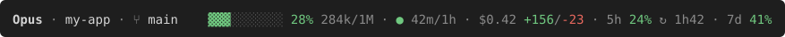
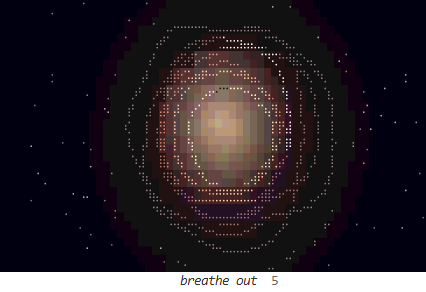

# claude-code-vibe-mods

**Hear Claude Code work.** A game announcer that calls HEADSHOT when Claude lands a fix, a breathing break
for when a session runs hot, and a status line that shows what the session is costing you.

<p>
  <a href="https://github.com/asfbr/claude-code-vibe-mods/actions/workflows/test.yml"></a>
  <a href="LICENSE"></a>
  
  
  
</p>

They run beside the conversation, not in it. Claude never sees what they draw or play, so they cost no
tokens. The one exception is the announcer's optional line in `CLAUDE.md` (about 150 tokens, cached),
which tells Claude which call to make.

| | What you get |
|---|---|
| [**announcer**](announcer/) | Claude finishes a task and Unreal Tournament's announcer calls it: HEADSHOT for one clean fix, MULTI KILL when several parts land, WINNER on a deploy. Five voices, Quake III included. On the way, a short sound and a one-line animation for what Claude does: asks you something, opens a permission dialog, commits, pushes, fails a test, starts an `rm -rf`. You know when Claude needs you without watching the terminal. |
| [**breathe**](breathe/) | 30 seconds of guided breathing in a pane beside the chat, with a drone that swells with each breath. Run `/breathe`, set a schedule, or let it open by itself when your prompts start running hot ("still broken??"). |
| [**statusline**](statusline/) | One row: context fill, a countdown to when the prompt cache goes cold (and the next turn gets expensive), session cost, and your 5-hour and weekly limits with their reset times. |



| Breathe in | Breathe out |
|---|---|
|  |  |

## Install

In Claude Code 2.1.275 or later, one line per mod:

```
/plugin install announcer --marketplace asfbr/claude-code-vibe-mods
/plugin install breathe --marketplace asfbr/claude-code-vibe-mods
```

Their options are in `/config`. Nothing else to install: no Python, no pip, no npm. The announcer's README
has its `CLAUDE.md` line and how to build the game voices (Python 3, standard library only).

The status line isn't a mod: it needs [a clone](#from-a-clone) and Node 18+, plus one block in
`settings.json` from [its README](statusline/).

### Or ask Claude

These mods run code on your machine, so it's fair to have Claude read them first. Paste this into Claude Code:

```
Read https://github.com/asfbr/claude-code-vibe-mods. Tell me what each mod runs on my machine and anything I
should know before installing it. Then install the announcer and breathe, and set up the status line.
```

### From a clone

To change the mods or keep the game voices across updates:

```sh
git clone https://github.com/asfbr/claude-code-vibe-mods ~/claude-code-vibe-mods
```

Then point Claude Code at the folders in `~/.claude/settings.json` (`;` separates them on Windows, `:`
elsewhere) and restart:

```json
"env": { "CLAUDE_CODE_PLUGIN_DIRS": "~/claude-code-vibe-mods/announcer;~/claude-code-vibe-mods/breathe" }
```

## Platforms

Built and used on Windows. The panes, cues and tests run wherever Claude Code does. The sounds and the
breathing window use the PowerShell and Edge built into Windows, so elsewhere the announcer plays through Claude Code's own audio
player and breathe is silent.

## The game voices

The win calls are the original Unreal Tournament and Quake III announcers. They belong to Epic Games and
id Software, so this repo doesn't include them. `announcer/scripts/sounds.py` downloads the original game
files from public archives (archive.org, id's own demo mirror) and cuts the clips on your machine. Until you
run it, a win plays a free sound instead.

## Contributing

Want a mod to work differently? Before forking, consider opening an issue or a pull request here: what
helps you probably helps the next person too. [CONTRIBUTING.md](CONTRIBUTING.md) has the tests and the rules.

## Credits

- Action sounds: Kenney (CC0), Freesound authors (CC0), NASA (public domain), and one CC-BY 3.0 clip. Each
  one is listed in [`announcer/sounds/free/CREDITS.md`](announcer/sounds/free/CREDITS.md).
- Unreal Tournament is a trademark of Epic Games; Quake is a trademark of id Software. This project is
  not affiliated with either, or with Anthropic.

## License

[MIT](LICENSE) for the code. The sound clips keep their own licences (above).
