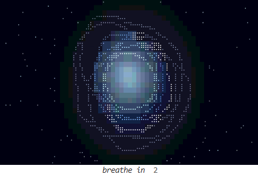

# breathe

Claude Code mod: a short breathing exercise in a pane beside the chat. A soft core inside a nebula of uneven,
drifting contour lines grows as you breathe in and shrinks as you breathe out; one line lights up as the phase's
timer, and dust gathers in on the breath and scatters out. Each phase has its colours (icy in, violet held full,
amber to rose out, indigo held empty), and a low organ drone with a long reverb swells with the breath. It closes
itself after 30 s by default; `/breathe stop` closes it sooner, the pane or the window, even mid-turn. So do Esc
at an empty, idle prompt and, in the fullscreen terminal, the pane's stop button or close mark (the main screen
reports no clicks, so there they do nothing). Zero tokens: nothing it does reaches the model.



In the terminal the picture is drawn in character cells, 30 frames a second: the glow as coloured half blocks,
the lines and dust as braille dots. A pane wider than the nebula widens it a little and fills the rest with
faint stars. The pane opens at once and takes no keys. The old Edge window is still there
(`where`: `window`), and opens instead wherever a pane cannot be drawn.

Three ways it opens:

- `/breathe` (or `/breathe box`, `/breathe 4-7-8`): runs at once, even mid-turn.
- **Hot prompts**: each prompt you type is scored locally, in English and Portuguese: "again?", "still broken",
  "quantas vezes", insults, ALL CAPS; code in backticks ignored. A swear counts when it is aimed: at Claude
  ("fuck you", "vai se foder"), at what broke ("the build is fucking broken", "porra, de novo"), or as a bare
  outburst ("fuck."). Any other swear, and `!!!`/`??`, only make the rest louder, so casual or glad swearing
  ("explain it fucking better", "holy shit it works") never opens it. The score fades by half every
  10 minutes and opens the window at 5 (`sensitivity`: 3 on high, 8 on low); repeats compound, so one very
  heated prompt can open it alone, and milder ones add up over a run. At most once an hour, across sessions.
  `/breathe heat` shows the score now, the last prompt's, and when the next break may open. The prompt itself
  goes on untouched.
  To score words of your own as insults, put them in `insults.local.txt` in this folder (gitignored): one per
  line, each a regex fragment matched as a whole word, case-insensitive (`dumb\w*` also catches "dumbest").
  Lines starting with `#` are comments. It is read when a session starts.
- **Schedule**: off by default. A pane Claude Code opens unasked waits below 144 terminal columns (110 once you
  have opened it yourself), so on a narrower terminal a scheduled break opens the window instead.

The window never takes the keyboard either: Windows keeps the foreground from it. The launcher pins it on top, and
keeps re-pinning it until it closes, since Edge drops the pin now and then and a covered Edge window stops animating.

## Setup (once per machine)

In Claude Code 2.1.275 or later:

```
/plugin marketplace add asfbr/claude-code-vibe-mods
/plugin install breathe@claude-code-vibe-mods
```

Or from a clone: in `~/.claude/settings.json`, add this folder to the mods list (`;` separates folders on
Windows, `:` elsewhere), and restart Claude Code. `claude plugin list` should show `breathe@inline ... loaded`.

```json
"env": { "CLAUDE_CODE_PLUGIN_DIRS": "~/claude-code-vibe-mods/announcer;~/claude-code-vibe-mods/breathe" }
```

## Options (`/config`)

- `where`: `pane` (default) or `window` (Edge, bottom-right of the screen, on top of everything).
- `anger`: `open` (default), `hint` (a status-line "rough one? /breathe" for 5 minutes), `off`. `sensitivity`:
  `high` (opens at 3), `normal` (5, default), `low` (8). `cooldown`: 30 min, 1 h, 2 h.
- `schedule`: `off` (default), 30 min … 2 h. Two sessions open still give one window per interval.
- `pattern`: `4-6` (in 4, out 6; default), `box` (4-4-4-4), `4-7-8`. `length`: 15 s, 30 s (default), 1 min, 2 min,
  rounded to whole breaths.
- `sound`: the drone. `volume`: 100% … 10% (default 35%).

## How it's built

`hooks/register.tsx` (triggers, the pane and its frame clock), `hooks/anger.ts` (the score), `hooks/sky.ts` (the
breath's timeline and the pane's picture as terminal cells, ported from the page), `ui/breathe.html` (the window's
page; `?p=` pattern, `s=` seconds, `v=` volume, so it opens straight in a browser too; there the sound waits for a
click), `scripts/launch.ps1` (Edge `--app` window with its own profile under `%LOCALAPPDATA%\claude-breathe`, placed
and pinned).

The window synthesises its drone in the page. The pane cannot, and Claude Code's own player is silent on Windows,
so `scripts/drone.py` renders the same synth offline into `sounds/drone-<pattern>.wav` (rerun it after changing
the synth or the timings; needs numpy) and `scripts/drone.ps1` stitches it to the run's length and plays it.

The pane runs anywhere Claude Code does, silent off Windows; the window is Windows only (PowerShell + Edge).
The window was checked at 100% display scaling on one monitor; other scalings and multi-monitor placement are
untested. The pane is drawn for the terminal; in the desktop app or the VS Code extension the window opens instead.

`claude plugin validate .` and `claude plugin test .` from this folder.
